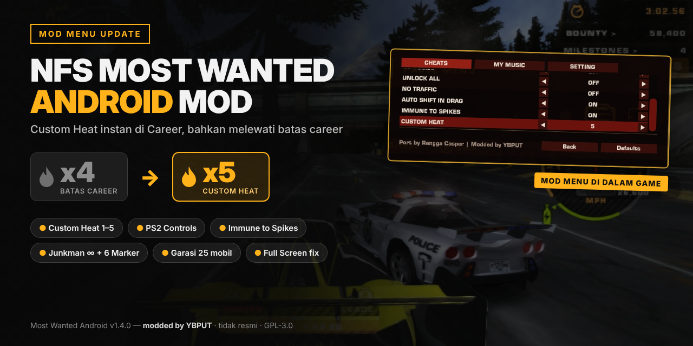

# Most Wanted Android — MOD by YBPUT

Modifikasi tidak resmi untuk [RanggaCasper/MostWanted-Android](https://github.com/RanggaCasper/MostWanted-Android) **v1.4.0**.
Proyek asli berlisensi **GPL-3.0**, dibangun di atas XboxXBE-Recomp (TGP482) dan host Android dari Black-Android.
Folder ini berisi skrip patch dan dokumentasi. **Tidak ada aset game di sini.**

> Unofficial mod. Not affiliated with or endorsed by Electronic Arts or the original author.
> Need for Speed is a trademark of Electronic Arts Inc. You need your own copy of the game.

## Fitur

**Junkman, Marker, dan Garasi**
- Pilihan marker setelah mengalahkan rival Blacklist: 2 → **6**.
- Junkman tidak habis setelah dipakai, dan semua kategori Backroom (Performance, Parts, Visual) tampil.
- Garasi Safe House: **15 → 25 mobil** (batas nyata save game).

**MOD MENU** (menu bawaan port, dengan tab dan baris baru)
- **CHEATS → Immune to Spikes**: kebal paku ranjau polisi.
- **CHEATS → Custom Heat (OFF, 1–5)**: heat level langsung berubah di Car Select, Career world map, dan saat dikejar polisi. Level 5 bisa dipakai walaupun career kamu belum membukanya. Selama Custom Heat aktif, level dikunci: pengejaran tidak menurunkan atau menaikkannya. OFF = game berjalan normal.
- **SETTING → PS2 Controls**: tata letak tombol ala PS2 untuk gamepad (dites dengan gamepad PS3). Pakai **Control Type 1** di menu Controls game.

  | Tombol | Fungsi |
  |---|---|
  | Silang (X) | Gas |
  | Kotak | Rem / mundur |
  | L1 | Nitrous |
  | R1 | E-brake |
  | Lingkaran | Speedbreaker |
  | Segitiga | Look Back |
  | R2 / L2 | Gigi naik / turun |
  | R3 | Ganti kamera |
  | Stik kanan atas / bawah | Gas / rem |
  | Select / Start | Reset Car / Pause |

- **SETTING → Github / Telegram**: tekan panah di samping OPEN untuk membuka halaman proyek dan kanal Telegram.
- **DEBUG**: tab khusus pengembang.
- Semua pilihan MOD MENU tersimpan otomatis (`MostWanted/ybput_mod.bin`), jadi tidak kembali ke OFF setelah game ditutup.
- Teks menu: "Port by Rangga Casper | Modded by YBPUT".

## Cara pasang

1. **Backup save** dulu: salin folder `MostWanted/hdd` ke tempat aman.
2. **Hapus** aplikasi Most Wanted resmi. Tanda tangan APK mod berbeda, jadi tidak bisa dipasang di atasnya.
3. **Pasang** APK mod dari halaman Releases repo ini.
4. Buka aplikasi dan siapkan ISO Xbox **NFS Most Wanted Black Edition (USA)** milikmu sendiri, sama seperti pada APK resmi. Kembalikan folder `hdd` hasil backup bila perlu.
5. Masuk game, lalu buka **MOD MENU** lewat ikon roda gigi (⚙) di tengah bawah layar. Tab yang tersedia: CHEATS, MY MUSIC, SETTING, DEBUG.

Tips:
- Custom Heat: atur level saat game di-pause; efeknya langsung berlaku begitu kamu lanjut bermain.
- PS2 Controls: aktifkan di tab SETTING, dan biarkan Control Type di menu Controls game tetap **1**.

## Batasan yang diketahui

- Garasi maksimal 25 mobil. Bila garasi penuh, mobil hadiah pink slip tidak masuk (tanpa crash). Jual satu mobil dulu.
- Selama Custom Heat aktif, heat tidak naik atau turun sendiri. Pilih OFF untuk kembali ke perilaku normal.
- Patch hanya berlaku untuk build v1.4.0. Daftar patch biner lengkap ada di `apply_patch.py`, untuk keterbukaan source sesuai GPL-3.0.

## Riwayat

Fitur, perbaikan bug, dan log perubahan: [`RELEASE_NOTES_modmenu.md`](RELEASE_NOTES_modmenu.md) dan [`CHANGELOG.md`](CHANGELOG.md).

## Kredit & lisensi

Seluruh kredit proyek asli tetap berlaku: RanggaCasper (port Android), TGP482 (XboxXBE-Recomp), Black-Android, bagasromadon (desain tombol), SDL, glslang, toml++, Dear ImGui.
Proyek asli dirilis di bawah **GPL-3.0** (lihat file `LICENSE` di root repo; jangan dihapus atau diubah).
Modifikasi ini, termasuk skrip dan dokumentasi di folder ini, juga dirilis di bawah GPL-3.0.

Modded by **YBPUT** · Telegram: https://t.me/ybputs
