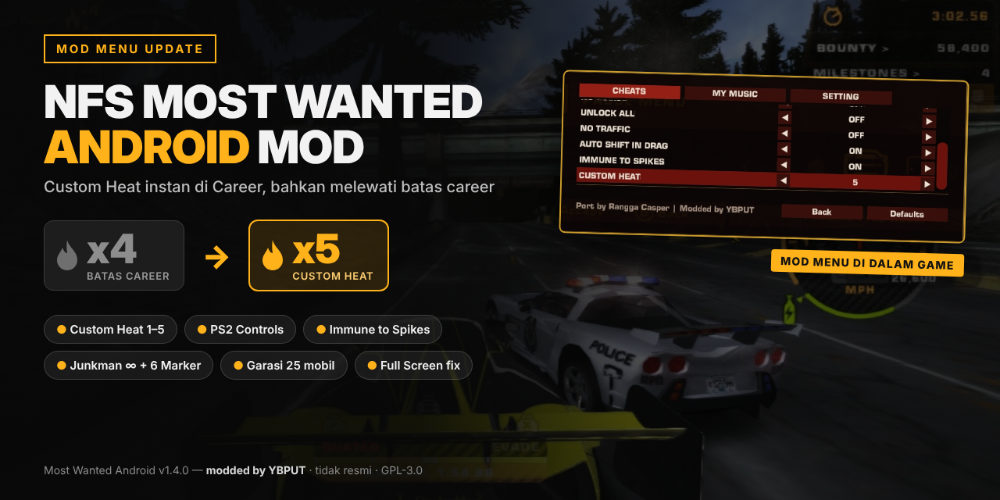

# Most Wanted MOD | MOD MENU Update | v1.4.0 — modded by YBPUT (tidak resmi)

Modifikasi dari [RanggaCasper/MostWanted-Android](https://github.com/RanggaCasper/MostWanted-Android) v1.4.0. Proyek asli GPL-3.0; modifikasi ini juga GPL-3.0. Source ada di repo ini, folder `junkman-mod/`.

## Fitur baru
- **Custom Heat (OFF, 1–5)** di tab CHEATS. Berlaku langsung di Car Select, Career world map, dan saat pengejaran. Level 5 bisa dipakai walaupun career belum membukanya, dan level dikunci selama Custom Heat aktif.
- **Immune to Spikes** di tab CHEATS: kebal paku ranjau polisi.
- **Tab SETTING** di MOD MENU:
  - **PS2 Controls**: tata letak tombol ala PS2 (Silang gas, Kotak rem, L1 Nitrous, R1 E-brake, Lingkaran Speedbreaker, Segitiga Look Back, R2/L2 gigi, R3 kamera, stik kanan gas/rem). Pakai Control Type 1.
  - **Github** dan **Telegram**: tombol OPEN langsung membuka halaman proyek dan kanal Telegram.
- **Tab DEBUG** (khusus pengembang).
- Pilihan MOD MENU tersimpan otomatis dan tetap ada setelah game ditutup.
- Teks menu "Port by Rangga Casper | Modded by YBPUT".

## Tetap ada dari rilis sebelumnya
- Marker setelah mengalahkan Blacklist: 2 → 6.
- Junkman tidak habis; semua kategori Backroom tampil.
- Garasi Safe House 25 mobil, dengan perbaikan crash pink slip saat garasi penuh.

## Bug yang diperbaiki
- Layar tidak full (ada bar hitam kiri-kanan) padahal Aspect Ratio sudah Full Screen. Rasio layar kini selalu dihitung ulang dari ukuran layar.
- Custom Heat hanya bekerja di Car Select. Sekarang juga di world map dan saat dikejar polisi.
- Custom Heat level 5 berganti-ganti 4/5 saat pengejaran (tertahan batas heat career). Sekarang stabil di level pilihan.
- Layar putih terang saat mengganti level heat.
- Tombol panah kiri (<) Custom Heat tidak berfungsi.
- Pilihan MOD MENU kembali OFF setiap game dibuka.
- PS2 Controls tidak aktif saat berkendara dan tombolnya tertukar (L1 jadi gas, stik kanan tidak berfungsi).
- Baris Immune to Spikes tidak muncul di tab CHEATS.
- Pilihan Custom Heat level 6 (tidak berfungsi) dihapus.

## Log perubahan (ringkas)
- MOD MENU: tab SETTING dan DEBUG ditambahkan di kanan MY MUSIC.
- PS2 Controls dan DUMP Memory dipindah dari CHEATS ke SETTING.
- Custom Heat memakai fungsi heat bawaan game (bukan lagi hanya menulis data save), lalu dikunci di penyimpan heat mobil pemain.
- Efek transisi level heat dilewati selama Custom Heat aktif.
- Syarat aktif PS2 Controls: hanya saat balapan/berkendara dan tidak ada menu terbuka, jadi navigasi menu tetap normal.
- Log teknis lengkap: `junkman-mod/CHANGELOG.md`.

## Cara pasang
1. Backup folder `MostWanted/hdd` (save).
2. Hapus aplikasi resmi (tanda tangan berbeda).
3. Pasang APK ini.
4. Siapkan ISO Xbox NFS Most Wanted Black Edition (USA) milik sendiri seperti pada APK resmi.
5. Buka MOD MENU lewat ikon roda gigi (⚙) di tengah bawah layar.

APK tidak berisi aset game.
File: `NAMA_APK_BARU.apk`
SHA-256 APK: `ISI_SETELAH_APK_JADI`

Kredit: RanggaCasper, TGP482 (XboxXBE-Recomp), Black-Android, bagasromadon, SDL, glslang, toml++, Dear ImGui.
Tidak berafiliasi dengan Electronic Arts. Need for Speed adalah merek dagang Electronic Arts Inc.
Modded by YBPUT · https://t.me/ybputs
